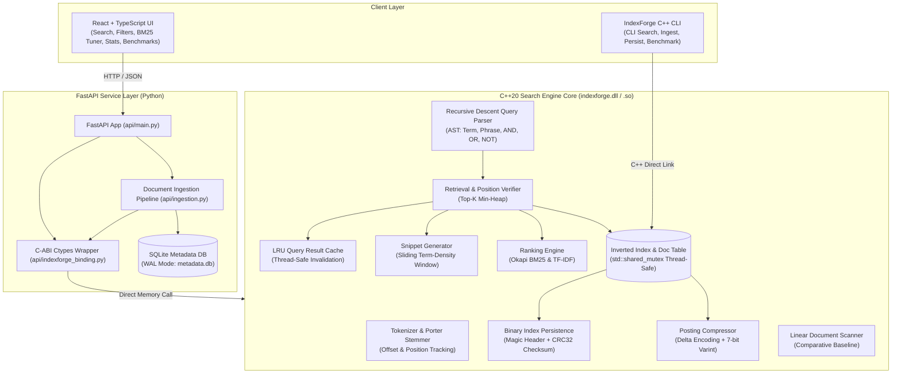
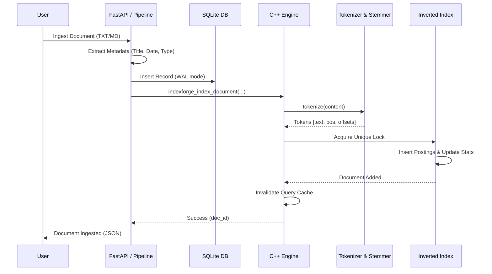
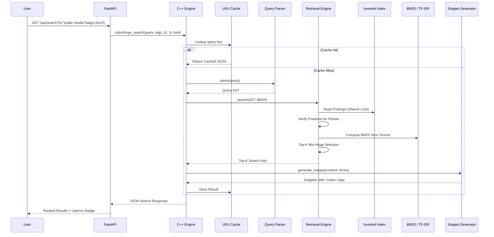

# IndexForge System Architecture

## 1. System Overview

**IndexForge** is a production-grade full-text search engine built from first principles. It provides sub-millisecond retrieval, relevance ranking, and exact phrase matching across unstructured document collections without delegating to third-party search engines like Elasticsearch, Lucene, or Solr.

The system is organized into decoupled layers:
1. **C++20 Search Core:** High-performance inverted index, postings compression, Porter stemmer, recursive descent query parser, Okapi BM25 and TF-IDF rankers, and CRC32-validated binary persistence.
2. **Persistence & Metadata Layer:** Dual-storage architecture combining a compact binary index file format (`.forge`) with SQLite (WAL mode) for metadata queries and document text storage.
3. **API & Orchestration Layer:** Python FastAPI service wrapping the C++ core via a zero-IPC C ABI (`ctypes`), exposing asynchronous REST endpoints.
4. **User Interface Layer:** React + TypeScript frontend supporting real-time search, ranked hits, `<mark>` snippet highlighting, BM25 hyperparameter tuning ($k_1$, $b$), document ingestion, index health inspection, and live benchmarking.

---

## 2. High-Level Architecture Diagram

---

## 3. Subsystem Breakdown

### 3.1 Document Ingestion & Text Extraction
- **Supported Formats:** TXT, Markdown (`.md`), and raw text extracted from PDF filings.
- **Metadata Extraction:** Automatically extracts document title, issuing source/agency, date, and document type (`tender`, `notice`, `policy`, `regulation`, `tech_doc`).
- **Resilience:** Empty documents, documents with whitespace/punctuation only, and malformed inputs are handled gracefully without engine faults.

### 3.2 Text Processing & Normalization
- **Tokenizer:** Splits text on non-alphanumeric boundaries while preserving hyphens and underscores within words.
- **Position Tracking:** Tracks token positions (0-indexed) for exact phrase adjacency validation.
- **Byte Offsets:** Preserves character start and end offsets in the original raw text for snippet highlighting.
- **Stop-Word Filtering:** Comprehensive English stop-word set based on information retrieval standards.
- **Porter Stemmer:** Complete algorithmic implementation of Martin Porter's 1980 stemming algorithm across steps 1a, 1b, 1c, 2, 3, 4, 5a, and 5b.

### 3.3 Inverted Index Architecture
- **Term Dictionary:** Hash map mapping normalized terms to postings lists.
- **Postings List:**
  $$\text{Posting} = \langle \text{doc\_id}, \text{term\_frequency}, [\text{pos}_0, \text{pos}_1, \dots, \text{pos}_k] \rangle$$
- **Document Store:** Fast lookup for document metadata, document length $|D|$, and unique term counts.
- **Tombstoning & Deletion:** $O(1)$ deletion via atomic tombstone set (`deleted_docs_`). Postings lists remain valid until background compaction (`compact()`).
- **Concurrency:** Reader-Writer lock (`std::shared_mutex`) enabling multiple concurrent read-only queries (`std::shared_lock`) while mutations (indexing, deletion) acquire a unique lock.

### 3.4 Postings List Compression (Delta + Variable Byte)
- **Delta Encoding ($d$-gap):** Sorted document IDs $d_0, d_1, d_2$ are stored as $d_0, d_1 - d_0, d_2 - d_1$. Token positions $p_0, p_1, p_2$ are similarly delta-encoded.
- **Variable-Byte (VByte):** Encodes integers using 7 bits per byte with the most significant bit (MSB) as a continuation flag.
- **Memory Impact:** Reduces serialized postings size by **55% to 64%** compared to uncompressed 32-bit arrays.

### 3.5 Ranking Engine
#### Okapi BM25
The BM25 score for document $D$ given query $Q$ is computed as:
$$\text{Score}_{\text{BM25}}(D, Q) = \sum_{t \in Q} \text{IDF}(t) \cdot \frac{f(t, D) \cdot (k_1 + 1)}{f(t, D) + k_1 \cdot \left(1 - b + b \cdot \frac{|D|}{\text{avgdl}}\right)}$$
Where:
- $\text{IDF}(t) = \ln\left(1 + \frac{N - n(t) + 0.5}{n(t) + 0.5}\right)$ (Lucene-style non-negative IDF)
- $f(t, D)$ is the term frequency of $t$ in $D$.
- $|D|$ is the document length (token count), and $\text{avgdl}$ is the corpus-wide average document length.
- $k_1$ (default 1.2) controls term frequency saturation.
- $b$ (default 0.75) controls document length normalization.

#### TF-IDF (Vector Space)
$$\text{TF-IDF}(D, Q) = \sum_{t \in Q} (1 + \ln(f(t, D))) \cdot \left(1 + \ln\left(\frac{N + 1}{n(t) + 1}\right)\right) \cdot \frac{1}{\sqrt{|D|}}$$

### 3.6 Query Parser & AST
Recursive descent parser supporting:
- Single & multiple keywords (`public tender contract`)
- Exact phrases with position verification (`"public tender"`)
- Boolean expressions (`AND`, `OR`, `NOT`, `+`, `-`, `!`)
- Grouping with parentheses: `(tender OR grant) AND federal`
- Precedence: `NOT` > `AND` > `OR`.

### 3.7 Snippet Generator
- Analyzes candidate document tokens against query terms.
- Evaluates a sliding character window (~220 chars) to locate the region of highest matched term density.
- Snaps window boundaries to word edges.
- Wraps matched terms in `<mark>` tags for frontend rendering.

### 3.8 Persistence & Integrity Verification
- Custom binary format with magic header `0x49445846` (`"IDXF"`), version `1`.
- Serializes corpus metadata, documents, tombstones, and compressed postings lists.
- Calculates an **IEEE 802.3 CRC32 checksum** over the payload. On load, the checksum is verified before unpacking to protect against bit-rot or file truncation.

---

## 4. Lifecycle Walkthroughs

### 4.1 Indexing Lifecycle

### 4.2 Query & Retrieval Lifecycle

